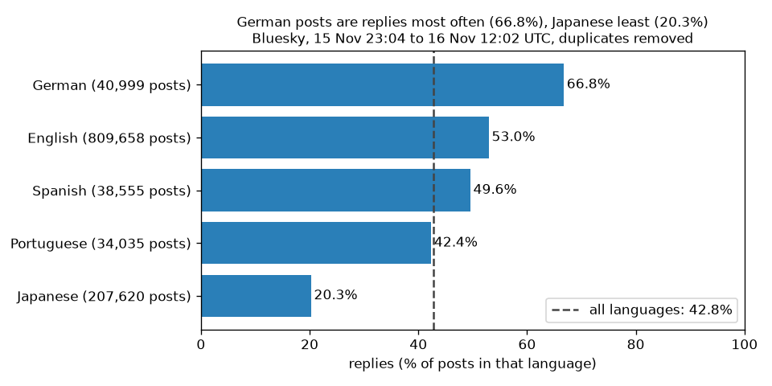

# Who replies on Bluesky? Reply share by language from a live post stream

**Bao Duong**  
**DS 3022 Data Project 3, Fall 2026**

## Data source

I'm pulling from Bluesky's public **Jetstream** firehose at `wss://jetstream2.us-east.bsky.network/subscribe?wantedCollections=app.bsky.feed.post`. It's a **push** stream: you open one WebSocket and the server shoves every new post, edit, and deletion at you as JSON. No API key, no account, no User-Agent required. A post includes the account ID (`did`), a microsecond timestamp (`time_us`), `kind = "commit"`, and a `commit` block with the operation type (create/update/delete), post ID (`rkey`), and the `record` itself—text, `langs` array, and optionally a `reply` reference if it's responding to another post. Jetstream also emits `identity` and `account` events, but those don't contain posts.

I ran the stream live from November 15 23:04 UTC to November 16 12:02 UTC—roughly 13 hours, averaging 34 messages per second. Jetstream supports replay via cursor (`&cursor=<time_us>`, going back about 36 hours), which the producer uses to reconnect without dropping messages, and which I leveraged for chaos card D5.

## How to run

Starting fresh with Docker Desktop running:

```bash
git clone https://github.com/baoware/ds3022-streaming.git
cd ds3022-streaming
python3 -m venv .venv
source .venv/bin/activate
pip install -r requirements.txt
docker compose up -d                                              # spins up 3 Redpanda brokers + Console on :8080
docker exec -it redpanda-0 rpk topic create bluesky_posts -p 3 -r 3   # do this before starting the producer, or it auto-creates with 1 partition
cd project3
```

Capture (three terminals, venv active, in `project3`):

```bash
python lander.py                    # T2: Kafka → data/raw/*.parquet
python producer.py                  # T1: Jetstream → Kafka. Ctrl+C once T3 hits 50,000+ raw
python four_numbers.py did,rkey     # T3: sanity check progress anytime
```

Kill the producer, wait ~70 seconds for the final partial batch to flush, then stop the lander. Then execute the pipeline:

```bash
prefect server start                # optional, separate terminal, dashboard available on :4200
python flow.py                      # processes full dataset in data/raw, outputs bluesky.duckdb and charts/reply_share_by_language.png
python flow.py data/sample          # runs without Kafka, using the committed sample data
```

If your Prefect profile has `PREFECT_API_URL` pointing at a dead server, you'll get "Failed to reach API". Start `prefect server start` first.

Chaos testing helpers: `python lander.py crash` (D1) and `python producer.py history 3` (D5, replays last 3 minutes).

## Architecture

```
Jetstream WebSocket (push, JSON)
        |
        v
producer.py      wraps in envelope {"action": "live" | "history", "data": <message>}, keyed by did
        |
        v
Kafka topic bluesky_posts   (3 partitions, 3 replicas, Redpanda)
        |
        v
lander.py        consumer group bluesky_posts_lander, batches 1,000 records or 60s per file,
        |        writes .tmp then renames, commits offsets only after file exists
        v
data/raw/bluesky_*.parquet   (one row per Kafka record, raw JSON preserved)
        |
        v
flow.py  (Prefect flow bluesky-pipeline, DuckDB output bluesky.duckdb)
   load_raw   raw_posts          every landed row
   stage      stg_records        one row per Kafka record, drops malformed/non-post events
   entities   posts              one row per post (did, rkey), latest operation, is_reply parsed
   marts      mart_reply_share   reply share for top 5 languages
   chart      charts/reply_share_by_language.png
```

## Design decisions

Each explained in 2-4 sentences, with my actual numbers.

1. **Key and partitions.** I keyed by account ID (`did`). Kafka hashes this, so every event from a single account lands in the same partition and maintains send order—critical for ensuring a create arrives before its corresponding delete. At 106,000 records, my three partitions held 34,865, 33,293, and 37,842 records respectively, with zero accounts spanning multiple partitions. Without a key, records scatter randomly; a delete could land on partition 2 while its create sits on partition 1, potentially processing out of order. Using just `rkey` fails too—it's only unique within an account, not globally.

2. **Batch size and time.** Files close at 1,000 records or 60 seconds, whichever triggers first. With Bluesky averaging ~34 posts/second across my 13-hour window, a batch fills in roughly 30 seconds, so the size threshold handles almost every file. That yields ~120 files/hour, ~1,600 total for the run. The 60-second threshold only activates when I manually stop the producer (closing partial batches of 222 or 571 records).

3. **Offsets after the file.** If the lander dies after writing a file but before committing offsets, Kafka considers those records unprocessed, so a restart re-lands them. Card D1 demonstrates this perfectly: the crash file's 1,000 records appeared twice, and an unplanned Docker stop overnight likely caused another 852 duplicates. I accept this because the flow deduplicates later; whereas storing offsets first risks permanent data loss if the crash happens between offset commit and file completion.

4. **Duplicates.** Two rows represent the same Kafka record when sharing identical `kafka_partition` and `kafka_offset` values—this happens when files get landed twice. The `stage` step uses `SELECT DISTINCT * EXCLUDE (landed_at)` to scrub these (1,852 copies in my dataset). Two records represent the same *post* when sharing `did` and `rkey`—like a create and subsequent delete, or a replayed post from D5. The `entities` step applies `QUALIFY row_number() OVER (PARTITION BY did, rkey ORDER BY time_us DESC, kafka_offset DESC) = 1`, compressing 1,570,855 records down to 1,534,094 unique posts.

5. **Windows and time.** Analysis uses event time (`time_us`)—when Jetstream received the event—converted to UTC. Landing time would corrupt replayed data (D5 landed posts from 3 minutes prior) and the 7,571 records the lander caught up after Docker restarted. I apply no windowing since the question compares languages across the full 13 hours. Hourly windows would be the natural next step to test time-of-day effects mentioned in my Analysis.

6. **Ten times the volume.** At 10× my rate (~340 posts/second), the lander would close files every 3 seconds—1,200 tiny files/hour. The first bottleneck would be the flow, which currently rebuilds all tables from scratch each run; `stage` already consumes ~90 of 135 seconds due to `DISTINCT` comparing every column including full JSON blobs. I'd optimize by deduplicating only on `(kafka_partition, kafka_offset)`, incrementally loading new files only, and landing larger batches. Storage also becomes critical: 13 hours consumed 14.6 GB in Kafka with three replicas, so I'd implement retention limits.

## Chaos round

| Card | Prediction | Execution | Metrics (before → after) | Explanation |
|---|---|---|---|---|
| D1 Crash between file and offsets | Forgot to write this beforehand. | Stopped lander, ran producer for 30s, executed `python lander.py crash` (landed 1,000 records, exited before offset commit). Restarted lander normally. | raw: 115,776 → 118,998 (116,776 immediately post-crash); malformed: 0 → 0; unique Kafka records: 115,776 → 117,998; unique did+rkey: 109,057 → 111,207 | The 1,000 crash-file records were re-read and re-landed, so raw count sits exactly 1,000 above unique Kafka records. Nothing lost (at-least-once). `SELECT DISTINCT` cleans the copies in staging. Unique posts increased only from new data flowing during the 30 seconds. |
| D2 Poison message | Forgot to write this beforehand. | `docker exec -it redpanda-0 rpk topic produce bluesky_posts -k bad`, entered `this is not JSON` (partition 1, offset 42902), waited for next file | raw: 118,998 → 154,998; malformed: 0 → 1; unique Kafka records: 117,998 → 153,997; unique did+rkey: 111,207 → 146,202 | `to_row()` trapped the JSON error, landing the text with `action = 'malformed'`, keeping the lander alive and the partition unblocked. Flow retains it in `raw_posts` but excludes from `stg_records`. Other counts rose because the producer continued running. Raw minus unique Kafka records went 1,000 → 1,001 (the poison message). |
| D5 Send it all again | Forgot to write this beforehand. | `python producer.py history 3`: reconnected with cursor 3 minutes back (23:42:55 UTC), blasted 8,221 records in seconds, then Ctrl+C | raw: 107,555 → 115,776; malformed: 0 → 0; unique Kafka records: 107,555 → 115,776; unique did+rkey: 104,501 → 109,057 | Resent posts become new Kafka records with new offsets, so raw and unique Kafka records both jumped 8,221—`DISTINCT` can't catch these. The entity deduplication (by `did, rkey`) does. Unique posts still rose 4,556 because my replay window extended past when I originally stopped the producer. Of 7,806 replayed posts, 3,464 were duplicates and 4,342 were new. |

I also suffered an unplanned D1. Docker crashed overnight while everything was running. After restart, brokers showed leader changes (partition epochs 15→17), and the lander—having stored offsets but not yet committed them—re-landed 852 records. Final tally: 1,852 total duplicates (1,601,207 raw minus 1,599,354 unique Kafka records minus 1 malformed), all removed by the stage step.

## The four numbers

From flow logs on full data (`docs/flow_log.png`, consistent across two runs):

| Metric | Full data | Sample (`data/sample`) |
|---|---:|---:|
| Raw records landed | 1,601,207 | 5,000 |
| Malformed (retained in raw) | 1 | 0 |
| Unique Kafka records | 1,570,855 | 4,921 |
| Unique posts (did, rkey) | 1,534,094 | 4,921 |

"Unique Kafka records" counts post events only. The stage step also drops 28,499 Jetstream `identity` and `account` events, which is why `four_numbers.py` (counting all valid records) shows 1,599,354. The sample is 5,000 random rows from the full dataset—happening to contain no malformed rows or duplicates—yet the flow still executes all cleaning steps.

## Challenges / Obstacles

The real friction was infrastructure and long-running behavior, not code logic. Docker wasn't installed on my Mac initially. My first producer run happened before manual topic creation, so Redpanda auto-created `bluesky_posts` with 1 partition/1 replica; I nuked it, recreated with `-p 3 -r 3`, and restarted. Redpanda Console showed perfectly equal partition counts, which looked like keying was broken, but DuckDB confirmed the actual distribution: 34,865, 33,293, and 37,842 records, zero cross-partition accounts, zero null keys. My Prefect profile still pointed at Project 2's server, causing "Failed to reach API" until I ran `prefect server start`. I left the pipeline running overnight; Docker stopped, brokers elected new leaders (epochs 15→17), and upon restart `rpk group describe` showed 7,571 records of lag, which the lander eventually chewed through. At that point the topic held 1.6M records and 14.6 GB, so once everything was landed and verified, I purged the Docker volumes. Early test data showed some posts tagged `en-US` rather than `en`, so the flow now strips language codes to base tags only. My debugging toolkit: `four_numbers.py` after every operation, `rpk` for topic/consumer group inspection, and ad-hoc DuckDB queries against raw Parquet.

## Analysis

Question: How does reply share vary across the five most common languages on Bluesky?

Over 13 hours (Nov 15 23:04–Nov 16 12:02 UTC, 1,534,094 unique posts), 42.8% of all posts were replies, but language breakdowns diverge dramatically. German posts were replies 66.8% of the time, English 53.0%, Spanish 49.6%, Portuguese 42.4%, while Japanese posts were replies only 20.3% of the time. The counterintuitive finding: volume doesn't correlate with conversational density. English produced ~20× the post volume of German, yet German showed the highest reply ratio. Conversely, Japanese—the second-largest language—was mostly original posts (four in five). This ranking isn't noise: a 2-minute test on Nov 12 showed identical ordering (German 63.4%, Japanese 17.2%), with only English/Spanish swapping positions.

Major limitation: time-of-day bias. My window captured Japanese daytime but European/American night/early morning, so demographics (who's awake) may drive the gap rather than intrinsic language behavior. Additionally, language tags reflect the posting app's declared primary language, which may mismatch actual text content.

## Plot / Visualization



Posts whose latest event is a create (excluding deleted), after duplicate removal, grouped by the first language declared by the posting app. Each bar shows that language's reply percentage; dashed line indicates global average across all languages.

## Reflection

Before October 22, I assumed streams delivered data once, in order, by default. This project taught me those are guarantees you construct yourself. Committing offsets only after file creation gave me at-least-once delivery; I saw the cost when planned crashes and unplanned Docker stops produced 1,852 duplicate records. I learned duplicates bifurcate: `DISTINCT` catches re-landed records, but reposted content (new offsets) requires entity-level deduplication. Keying matters for ordering too—account keys preserve create-before-delete semantics. If restarting, I'd begin earlier (not cram into the final five days), create the topic before any producers run, document chaos predictions pre-execution, and collect a full 24-hour sample to enable hourly language comparisons.

## Acknowledgements

The producer, lander, and flow adapt from class scripts `quakes_producer.py`, `quakes_lander.py`, and `quakes_flow.py` (the producer itself derives from Professor Magee's `stream-seismic.py`). `four_numbers.py` comes from Guided Worksheet 2; `kit/make_sample.py` and `kit/check_project.py` are from the project kit. I used Claude (Anthropic) to help me adapt class scripts for Bluesky, draft flow SQL, and test the pipeline. I validated results by personally executing the full pipeline and comparing `four_numbers.py` output against flow logs at every step.
